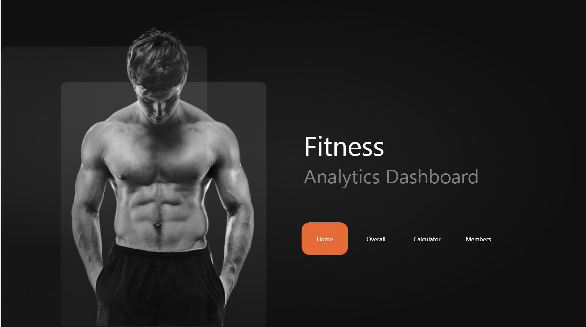
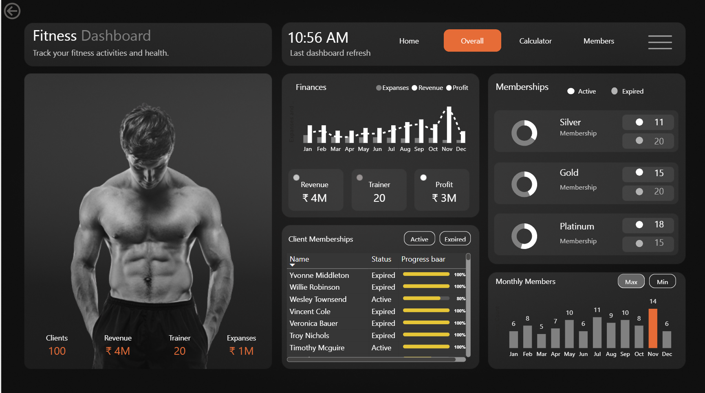
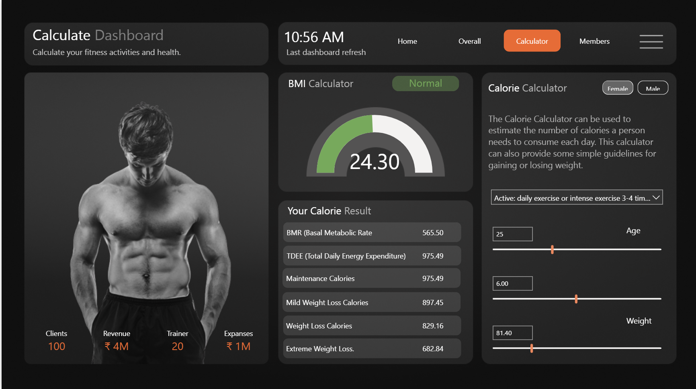
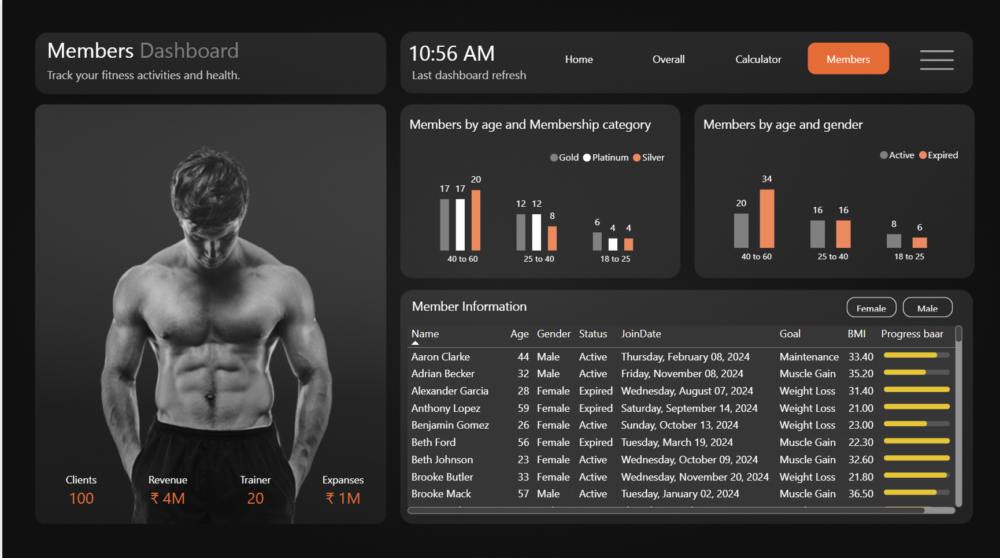

# 🏋️‍♂️ Fitness Analytics — Interactive Power BI Dashboard

A comprehensive **Power BI dashboard** designed in **Figma** and powered by a structured dataset (ready for CSV/Excel). It unifies **overall performance, monthly trends, membership status, health calculations, and member profiles**—so owners and managers can move from manual Excel summaries to **real‑time, drillable insights**.

👉 **Click below to explore the Gym Dashboard:**

---

## 🔹 Short Description / Purpose
This dashboard replaces manual reporting by providing a **single source of truth** for a fitness business. It covers **clients, trainers, revenue, expenses, profit, membership health, and BMI/BMR/TDEE calculators**, enabling quick decisions on **growth, retention, and profitability**.

---

## 🧰 Tech Stack
- 🎨 **Figma** — Visual design, layout, typography, color tokens, navigation states.
- 📊 **Power BI Desktop** — Visualizations, drill-through, interactions, tooltips.
- 📂 **Power Query** — Data cleansing, joins, date parsing, type conversions.
- 🗃️ **Data Modeling** — Star schema with a Calendar table for time intelligence.
- 🐘 **(Optional) PostgreSQL** — Source database for members, trainers, transactions.

---

## 📚 Dataset Overview (Dummy/Anonymized)
Typical tables used:
- `members` (ID, name, gender, age, contact, address)
- `trainers` (ID, name, specialization, hire_date)
- `memberships` (member_id, tier, start_date, end_date, status: Active/Expired/Cancelled)
- `invoices` (invoice_id, member_id, trainer_id, amount, invoice_date, item_type)
- `expenses` (expense_id, category, amount, expense_date)
- `attendance` (member_id, date, checkin_time)
- `health_metrics` (member_id, record_date, height_cm, weight_kg, bmi)
- `calendar` (date, year, month, month_name, quarter, month_index)

> Works with PostgreSQL or flat files. Power Query shapes everything into a clean star schema for fast visuals.

---

## ✨ Business Requirements → Solutions

### Problem Statement 1 — Overall Business Performance
**Manual pain:** Summing totals every time for clients, trainers, revenue, expenses, profit.  
**Dashboard solution:** The **Overall** page shows KPI tiles, trend cards, and breakdowns for:
- **Total Clients (distinct)**  
- **Total Trainers (distinct)**  
- **Total Revenue (sum of invoices)**  
- **Total Expenses (sum of expenses)**  
- **Total Profit (Revenue – Expenses)**  

> Added **drill-through to Members** and **Trainer filter** to study the drivers behind profit.

---

### Problem Statement 2 — Monthly Performance Tracking
**Manual pain:** Month-wise comparison takes time; no quick view of expenses vs revenue vs profit.  
**Dashboard solution:** The **Overall** page includes:
- **Monthly Revenue** (column or line)
- **Monthly Expenses** (column)
- **Monthly Profit** (line/overlay)
- **Side-by-side** Expense vs Revenue with **Profit** overlay for the same month

> Toggle between **CY/LY** (if available) and slicers for **Month/Quarter/Year**.

---

### Problem Statement 3 — Membership Status Tracking
**Manual pain:** No quick snapshot of active/expired across tiers; difficult to track who is expiring soon.  
**Dashboard solution:** The **Members** page offers:
- **Tier Overview** (Platinum/Gold/Silver): **Active vs Expired** counts (donuts or stacked bars)
- **Status Tracker** per member: **Expiring Soon** (within N days), **Expired**, **Cancelled**
- **Progress Bars** beside each member’s row (e.g., days elapsed vs total membership days)
- **Filters**: Tier, Status, Gender, Age band, Trainer

> Insight cards show **expiring within 7/14/30 days** to power proactive retention.

---

### Problem Statement 4 — Fitness & Health Calculations
**Manual pain:** Need a calculator for BMI/BMR/TDEE based on age, weight, height, gender, and activity.  
**Dashboard solution:** The **Calculator** page includes:
- **BMI Gauge** with category label (Underweight/Normal/Overweight/Obese)
- **Calorie/Metabolism panel** with:
  - **BMR** (Mifflin–St Jeor)
  - **TDEE** (BMR × Activity Multiplier)
  - **Maintenance Calories**
  - **Weight Loss / Gain calorie targets** (e.g., ±15–20% scenarios)
- **Input controls** (sliders/selectors) for **Age, Height, Weight, Gender, Activity Level**

> **Typical activity multipliers**:  
> Sedentary **1.2**, Light **1.375**, Moderate **1.55**, Very Active **1.725**, Extra Active **1.9**.  
> **BMR (Mifflin–St Jeor):**  
> Male = 10×W(kg) + 6.25×H(cm) − 5×Age + 5  
> Female = 10×W(kg) + 6.25×H(cm) − 5×Age − 161

*(For education only; not medical advice.)*

---

### Problem Statement 5 — Member/Client Detailed Profile
**Manual pain:** Getting a full member picture requires checking many sheets.  
**Dashboard solution:** The **Members** page (with row-level drill or right‑pane profile) shows:
- **Personal info**: Name, Age, Gender, Contact, Address  
- **Membership**: Tier, Start Date, Expiry Date, Status, Renewal flag  
- **Engagement**: Attendance streak, last check‑in  
- **Health**: Latest height/weight/BMI trend  
- **Financials**: Lifetime value, last invoice amount, trainer assigned  
- **Controls**: Gender/Status toggles and Tier chips for quick filtering
---

## 📑 Page‑by‑Page Walkthrough (Design + Visuals + Insights)

### 0) 🏠 Home (Landing)
- **Purpose:** Brand entry, one‑click navigation (Home • Overall • Calculator • Members)
- **Hero panel:** Fitness motif and short purpose statement
- **Actions:** Buttons route to each page; top‑right shows **last refresh** time

**Why it matters:** Sets context for demos and stakeholders; keeps navigation consistent.

---

### 1) 📈 Overall (Performance)
**KPIs (top row):** Clients • Trainers • Revenue • Expenses • Profit  
**Visuals:**
- **Finances trend** (Jan–Dec): expenses vs revenue with profit overlay
- **Memberships** donut/stack: **Active vs Expired** by tier (Silver/Gold/Platinum)
- **Monthly Members** columns: new joins per month (with Max/Min markers)
- **Client Membership table**: Name • Status • Progress bar (% of membership elapsed)

**Insights to look for:**
- Do **expenses** spike in specific months (marketing, equipment)?
- Which **tier** contributes most to **active base**?
- Is **profit** seasonal? What correlates with **new joins**?

---

### 2) 🧮 Calculator (BMI/BMR/TDEE)
**Left:** KPI cards (Clients, Revenue, Trainers, Expenses) for context  
**Center:** **BMI Gauge** with label (e.g., “Normal”)  
**Right panel:**  
- **Activity Level** dropdown  
- **Sliders**: Age, Height, Weight, Gender toggle  
- **Results panel:** BMR, TDEE, Maintenance, Mild/Normal/Extreme weight‑loss targets

**Insights:**
- Use calculator in onboarding to suggest **calorie targets** and **program plans**.
- Save calculated **maintenance calories** as a field in `health_metrics` for future tracking (optional).

---

### 3) 👥 Members (Status & Cohorts)
**Top band:** Last refresh, navigation chips  
**Visuals:**
- **Members by age & tier** (Gold/Platinum/Silver) — stacked bars  
- **Members by age & gender** — Active vs Expired comparison  
- **Member Information table** — Name • Age • Gender • Status • JoinDate • Goal • BMI • Progress bar  
- **Header chips:** Gender filter (Female/Male) + quick tier/status chips

**Insights:**
- Spot **at‑risk cohorts** (e.g., older age bands with higher expiry).
- Track **expiring soon** list and assign **trainer follow‑ups**.
- Compare **gender/tier mix** to optimize marketing.

---

## 🎛️ Interactions & UX
- **Global slicers:** Month/Quarter/Year, Membership Tier, Status, Gender, Trainer
- **Cross‑highlighting:** Click any bar to filter the entire page
- **Drill‑through:** Overall ➜ Members (member profile); Members ➜ trainer/nutrition notes (optional)
- **Tooltips:** Mini‑cards with MoM/YoY deltas, last activity date, remaining days to expiry
- **Nav bar:** Persistent across pages; “Last dashboard refresh” time shown

---

## 🔧 Data Modeling Notes (No DAX)

### ✅ Star Schema (Recommended)
**Fact tables:**  
`invoices` (revenue), `expenses`, `memberships`, `attendance`, `health_metrics`  
*(Optional)* `trainer_commissions`, `products_services`

**Dimensions:**  
`members`, `trainers`, `membership_tiers`, `expense_categories`, `gender_dim`, `activity_levels`, `calendar`

> Mirrors your earlier pattern (Hospital/Spotify) for performance and maintainability.

### ✅ Calendar Table
Continuous `date` range with:
- `Year`, `Quarter`, `Month`, `MonthName`, `MonthIndex` (1–12)  
- Relationships to facts via `invoice_date`, `expense_date`, `start_date`/`end_date` (use inactive relationships + `USERELATIONSHIP` where needed)

### ✅ Keys & Relationships
- `invoices.member_id  → members.member_id`
- `invoices.trainer_id → trainers.trainer_id`
- `memberships.member_id → members.member_id`
- `attendance.member_id → members.member_id`
- `health_metrics.member_id → members.member_id`
- `expenses.category_id → expense_categories.category_id`
- **Dates via** `calendar[date]` → `invoices.invoice_date`, `expenses.expense_date`, `memberships.start_date` *(inactive secondary relationships for end_date)*

### ✅ Power Query (Shaping)
- Enforce types: dates, decimals, whole numbers
- Trim/clean text; unify casing for joins (e.g., upper on keys)
- Merge to add descriptive attributes (e.g., join `membership_tiers` for tier names)
- Derive: `year`, `month`, `month_index`, `age_band` (e.g., 18–25, 26–35, 36–45, 46–60)
- Build **status helpers**: `expiring_soon` (end_date within 30 days), `expired` (end_date < today), `active` (today between start and end)
- Optional **denormalization** for the Members table to speed listing visuals

### ✅ Metric Definitions (Business Rules)
- **Total Clients** = distinct count of `members`
- **Total Trainers** = distinct count of `trainers`
- **Revenue** = sum of `invoices.amount`
- **Expenses** = sum of `expenses.amount`
- **Profit** = Revenue − Expenses
- **Monthly Members** = count of `memberships` starting in month
- **Membership Status** = Active/Expired/Cancelled (from dates & flags)
- **BMI** = `weight_kg / (height_m^2)`
- **BMR** = Mifflin–St Jeor (gender‑specific)
- **TDEE** = `BMR × activity_multiplier`

---
## 📸 Dashboard Screens

### 🏠 Home
.

### 📊 Overall
.

### 🧮 Calculator
.

### 👥 Members
.

---
## 🔒 Notes
- Built on **dummy/anonymized** data.  
- This is **not medical advice**; calculator outputs are for **fitness guidance only**.
